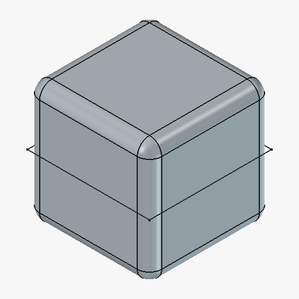

# Getting SolidMind CAD actually running

The upstream [README](README.md) describes the project. This file is the
*operational* companion: the exact steps that were run on a clean Ubuntu 24.04
machine to take this repo from a fresh clone to a working install, plus the two
things that silently break the install if you follow the README literally.

Everything below was executed and verified, not inferred.

---

## TL;DR

```bash
setup/install.sh              # installs everything (~10 min, mostly the 800 MB FreeCAD download)
freecad &                     # FreeCAD must be running before any cad.* tool works
setup/doctor.sh               # confirms all 9 links in the chain are up
```

Then start Claude Code in this directory and ask for a part:

> Make a 20mm cube with 2mm fillets on all edges

<p align="center">
  
</p>

That image is the actual verification screenshot the addon returned during
setup — the cube is real geometry in FreeCAD, not a mockup.

---

## What you need

| Requirement | Why | Notes |
|---|---|---|
| **Linux x86_64** | upstream is Linux-only | macOS/Windows unsupported; WSL2 is untested |
| **Python ≥ 3.12** | `requires-python` in `pyproject.toml` | **3.11 will not work** — see gotcha #1 |
| **Rust toolchain** | builds the `solidmind_geometry` kernel | `setup/install.sh` installs it via rustup if missing |
| **FreeCAD 1.1.0** | every `cad.*` tool runs inside it | 1.0.2 also supported; **0.21 is not** |
| **Claude Code** (or another stdio MCP host) | drives the 155 tools | reads `.mcp.json` automatically |

Simulation backends (Isaac Sim, Gazebo, Chrono) and the knowledge store are
**optional**. Nothing in the core modelling path needs them, and `setup/doctor.sh`
reports them as informational rather than failures.

---

## The two things that will silently break your install

Both of these cost real debugging time. `setup/install.sh` handles both.

### Gotcha 1 — Python 3.11 fails in a confusing way

Ubuntu 24.04 ships Python 3.12, but if your default `python3` is 3.11 (common on
Debian and on older images) `pip install -e .` fails inside the maturin build
backend rather than with a clean "wrong Python version" message. Build the venv
with an explicit interpreter:

```bash
python3.12 -m venv .venv
```

### Gotcha 2 — the addon symlink went into a directory FreeCAD doesn't scan

**Fixed in this repo** (`freecad_addon/InitGui.py` + `scripts/install_freecad_addon.sh`),
and submitted upstream. Recorded here because it's the failure you'll hit on any
checkout that predates the fix, and it gives you nothing to go on.

`scripts/install_freecad_addon.sh` used to symlink the addon into:

```
~/.local/share/FreeCAD/Mod/SolidMind
```

But **FreeCAD 1.1 keeps per-version user data in `~/.local/share/FreeCAD/v1-1/`**,
so that is not the directory it scans for addons. `InitGui.py` is never executed,
the socket server never starts, and port 9876 stays closed — FreeCAD opens
normally, the Report view is empty, and every `cad.*` call fails with
`CONNECTION_ERROR`.

Symlinking only into the versioned directory didn't work either, because
`InitGui.py` hardcoded the *legacy* path to put the repo root on `sys.path`:

```python
_mod_dir = Path.home() / ".local" / "share" / "FreeCAD" / "Mod" / "SolidMind"
_repo_root = str(_mod_dir.resolve().parent)
```

So the addon loaded but died immediately:

```
[SolidMind] Failed to start: No module named 'freecad_addon'
```

**The fix** removes the hardcoded path entirely. FreeCAD prepends each addon's
own directory to `sys.path` before exec'ing its `InitGui.py`, so the repo root is
recovered from there — correct wherever the addon is installed and whatever the
symlink is named. The install script asks FreeCAD for its data directory via
`FreeCAD.getUserAppDataDir()` instead of hardcoding `v1-1`, so it also covers
1.0.x and later versions. One symlink, in the right place:

```bash
scripts/install_freecad_addon.sh
```

Two things about `InitGui.py` worth knowing before editing it: FreeCAD execs it
with **no `__file__`**, and with **separate globals and locals mappings**. The
second one means helper functions and comprehensions defined in that file can't
see names defined alongside them — they resolve against the empty globals and
raise `NameError` at call time. That's why the resolution logic is written
inline with plain loops rather than factored into functions.

## Verifying it works

`setup/doctor.sh` walks the whole chain and tells you which link is broken:

```
MCP host (Claude Code) → bridge server (server.main) → TCP :9876 → FreeCAD addon → FreeCAD
```

A healthy run:

```
Python environment
  ✓ .venv present, Python 3.12
  ✓ server package imports
  ✓ solidmind_geometry (Rust kernel) imports

MCP bridge server
  ✓ bridge server responds — 155 tools exposed
  ✓ .mcp.json present (Claude Code will auto-start the server)

FreeCAD
  ✓ freecad on PATH
  ✓ addon linked: ~/.local/share/FreeCAD/v1-1/Mod/SolidMind

Live connection
  ✓ FreeCAD addon is listening on 127.0.0.1:9876 — cad.* tools will work

Summary: 8 passed, 0 failed, 0 warnings
```

The full test suite should also be green:

```bash
.venv/bin/python -m unittest        # 2624 tests, ~215s — 60 skip without sim backends
```

---

## The demo worth running first

The planetary gearbox is the best proof the stack is real. It needs FreeCAD
running, builds six parts, then **independently re-imports every STEP file and
re-measures it** against frozen interface specs:

```bash
PYTHONPATH=. .venv/bin/python examples/planetary_gearbox/run.py --out /tmp/gearbox
```

Verified output (~32 s):

```
[2/4] Dispatch 6 worker builds
  built 6 parts in 31.5s
[4/4] G5 (verify-mode validation — orchestrator re-measures every STEP)
    ✓ sun_gear        bore_dia: measured=6.0,  expected=6.0±0.2
    ✓ planet_1        bore_dia: measured=4.0,  expected=4.0±0.2
    ✓ planet_carrier  pin_circle_dia: measured=30.000021873765814, expected=30.0±0.5
    ✓ ring_gear       bore_dia: measured=50.5, expected=50.5±0.5

Result: ALL PARTS PASS
Speed ratio (closed-form, ring fixed): 5.00:1
```

It leaves real `.step` and `.stl` files (~90 MB) under `/tmp/gearbox/run/`, openable
in any CAD package.

Without FreeCAD running it exits cleanly with:
`ERROR: FreeCAD addon not reachable at 127.0.0.1:9876`.

---

## Running without a monitor (servers, containers, SSH)

The addon starts from FreeCAD's **GUI** startup path, so `freecadcmd` will not
load it — a headless box still needs a real FreeCAD window, just on a virtual
display. `setup/freecad-headless.sh` wraps that in Xvfb:

```bash
setup/install.sh --headless      # adds xvfb
setup/freecad-headless.sh start  # launches, waits for :9876, reports when ready
setup/freecad-headless.sh status
setup/freecad-headless.sh stop
```

Two things to know:

- **FreeCAD needs ~60–90 s** before the addon binds the socket. The launcher
  waits for you instead of returning early.
- **AppImages need FUSE**, which most containers lack. `setup/install.sh` detects
  this and extracts the AppImage instead (`--appimage-extract`), pointing
  `freecad` at the extracted `AppRun`. Functionally identical.
- Qt refuses to start under the `C`/`POSIX` locale, so the launcher sets
  `LC_ALL=C.UTF-8`.

The entire verification above — gearbox demo and filleted cube included — was
produced this way, on a machine with no graphics hardware.

---

## How you actually drive it

There is no GUI of its own and no CLI for modelling. The interface is an LLM
holding the MCP tools:

1. FreeCAD runs, addon listening on `:9876`.
2. Claude Code starts in this directory and reads `.mcp.json`, which launches
   `server/main.py` over stdio.
3. You describe a part in conversation. The model calls `cad.sketch`, `cad.pad`,
   `cad.fillet`, … and gets a rendered screenshot back after each operation, so
   it can see what it built and correct itself.
4. Clicks you make in the FreeCAD window come back through `cad.get_selection`.

The 155 tools split roughly into: `cad.*` (53) modelling, `geometry.*` (23)
parametric generators, `motion.*` (16) mechanism validation, `spec.*`/`design.*`
(20) design briefs, `analysis.*` (9) FEA/CFD, plus `study`, `rl`, `me`,
`knowledge`, `mfg`, `sim`, `dgraph`, `decide`.

For multi-subsystem assemblies there's a headless orchestrator with G0–G7 gates:
`python -m orchestrator`.

---

## Troubleshooting

| Symptom | Cause | Fix |
|---|---|---|
| `cad.*` calls hang, then `CONNECTION_ERROR ... after 3 attempts` | FreeCAD not running, or addon not loaded | `setup/doctor.sh`; start FreeCAD |
| FreeCAD is open but `:9876` never opens, nothing logged | addon not in the versioned `Mod` dir (gotcha #2) | `scripts/install_freecad_addon.sh` |
| `[SolidMind] Failed to start: No module named 'freecad_addon'` | pre-fix `InitGui.py` resolving the wrong root (gotcha #2) | `scripts/install_freecad_addon.sh` |
| `pip install -e .` fails in the maturin backend | Python < 3.12, or no Rust | `python3.12 -m venv .venv`; install rustup |
| `ModuleNotFoundError: solidmind_geometry` | Rust extension not built | `.venv/bin/maturin develop --manifest-path geometry/Cargo.toml` |
| `No suitable fusermount binary found` | no FUSE for the AppImage | extract it: `./FreeCAD_*.AppImage --appimage-extract` |
| `Could not load the Qt platform plugin "xcb"` | missing Qt X11 libs | `sudo apt-get install -y libxcb-cursor0 libxcb-xinerama0` |
| Qt complains about `ANSI_X3.4-1968` locale | `C`/`POSIX` locale | `export LC_ALL=C.UTF-8` |
| `motion.simulate` / `rl.*` fail on connection | Isaac/Gazebo/Chrono not installed | optional — see `docs/simulation-and-rl.md` |

Logs: `/tmp/solidmind-freecad.log` (headless launcher) and the FreeCAD
**Report view** (`View → Panels → Report view`) when running with a display.

---

## Keeping up with upstream

This repo tracks [John-Cusack/solidmind-cad](https://github.com/John-Cusack/solidmind-cad)
as a git remote, so upstream changes can be pulled in normally:

```bash
git fetch upstream
git merge upstream/main
```

Everything added here lives in `setup/` and this file — no upstream source is
modified, so merges stay clean.

---

## Honest status

Verified working on this machine:

- ✅ 2624 unit tests pass (60 skip — all need simulation backends)
- ✅ MCP bridge server exposes 155 tools
- ✅ Rust geometry kernel builds and imports
- ✅ FreeCAD addon connects; `cad.*` modelling produces real geometry and screenshots
- ✅ Planetary gearbox example: 6 STEP parts, all dimension checks pass
- ✅ Works fully headless under Xvfb

Not verified here (no GPU / not installed): Isaac Sim, Gazebo, Chrono, RL
training, OpenFOAM, and the LanceDB knowledge store.

Upstream is candid that the **outer** loop (orchestrator, G0–G7 gates, SBCE
ranking) is closed on five part classes, while much of the **inner** nine-step
iteration loop — particularly the *Reflect*, *Interpret* and *Decide* steps — is
still a roadmap item. Treat it as a very capable LLM-driven CAD co-pilot today,
not an autonomous engineer. See [`docs/ROADMAP.md`](docs/ROADMAP.md).
